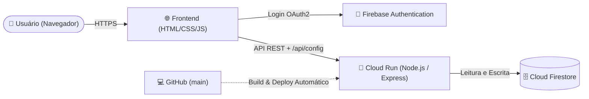

# 📋 Lista de Tarefas — Projeto de Estudo (CursoDevSENAI)

<p align="center">
  
  
  
  
</p>

Aplicação web full-stack de **Lista de Tarefas** desenvolvida como **objeto de estudo prático** para o curso **Técnico em Desenvolvimento de Sistemas — SENAI**, em apoio aos conteúdos reunidos no repositório [**CursoDevSENAI**](https://github.com/curtytech/cursodevsenai).

🌐 **Aplicação em produção:** [listadetarefas-app-160309533102.southamerica-east1.run.app](https://listadetarefas-app-160309533102.southamerica-east1.run.app)  
📚 **Repositório do curso:** [github.com/curtytech/cursodevsenai](https://github.com/curtytech/cursodevsenai)

---

## 🎓 Objetivo Educacional

Este projeto foi construído para demonstrar, na prática e de ponta a ponta, o ciclo de vida de uma aplicação web moderna publicada em nuvem, conectando os principais pilares estudados no curso:

| Pilar de Estudo | Como é aplicado neste projeto |
| :--- | :--- |
| **Lógica de Programação & JavaScript** | Manipulação do DOM, consumo de API com `fetch`, filtros de estado e validação de dados no cliente e no servidor. |
| **HTML5 & CSS3 Responsivo** | Interface limpa, acessível e adaptável de telas mobile (320px) a desktop com variáveis CSS e layout moderno. |
| **Backend & API REST (Node.js + Express)** | Rotas CRUD completas (`GET`, `POST`, `PUT`, `DELETE`), healthcheck (`/api/health`) e entrega segura de configuração (`/api/config`). |
| **Modelagem & Banco de Dados NoSQL** | Persistência em nuvem com **Google Cloud Firestore** isolando documentos por usuário (`userId`), com fallback em memória para testes locais. |
| **Autenticação & Segurança** | Login com conta Google via **Firebase Authentication**, isolamento de segredos em variáveis de ambiente (`.env` fora do Git) e páginas de privacidade/termos para OAuth. |
| **Containers & Cloud Computing (CI/CD)** | Empacotamento com **Docker** e deploy contínuo automático via **GitHub + Cloud Build + Google Cloud Run**. |

---

## 🏗️ Arquitetura da Aplicação



---

## ✨ Funcionalidades

- Criação de tarefas com título, descrição, categoria, prioridade (`Baixa`, `Média`, `Alta`) e data de prazo.
- Marcação de tarefas como concluídas e exclusão individual.
- Filtros rápidos por status (*Todas*, *Pendentes*, *Concluídas*) e *Alta Prioridade*, com contadores dinâmicos.
- **Modo Convidado** para testar imediatamente e **Login com Google** para manter a lista vinculada à conta do usuário.
- Fallback automático em memória quando executado localmente sem credenciais do Firestore.

---

## 📁 Estrutura do Projeto

```text
listadeTarefas/
├── public/
│   ├── index.html          # Interface principal da aplicação
│   ├── style.css           # Estilização responsiva
│   ├── app.js              # Lógica do frontend, autenticação e consumo da API
│   ├── privacidade.html    # Política de Privacidade (tela de consentimento OAuth)
│   └── termos.html         # Termos de Serviço (tela de consentimento OAuth)
├── server.js               # API REST Express + integração Firestore + Runtime Config
├── package.json            # Dependências e scripts npm
├── package-lock.json       # Lockfile de versões das dependências
├── Dockerfile              # Definição da imagem Docker para o Cloud Run
├── .dockerignore           # Arquivos ignorados no build do container
├── .env.example            # Modelo seguro de variáveis de ambiente (sem segredos)
├── .gitignore              # Proteção contra versionamento de .env e node_modules
└── README.md               # Documentação do projeto
```

---

## 🚀 Como Executar Localmente

### Pré-requisitos
- [Node.js](https://nodejs.org/) (v20 ou superior)
- [Git](https://git-scm.com/)

### Passo a passo

1. Clone o repositório e acesse a pasta do projeto:
   ```bash
   git clone https://github.com/oscarmoraes/listadetarefas.git
   cd listadetarefas
   ```

2. Instale as dependências:
   ```bash
   npm install
   ```

3. Crie seu arquivo `.env` local a partir do modelo:
   ```bash
   cp .env.example .env
   ```
   *(Preencha as variáveis `FIREBASE_*` no `.env` caso queira testar o login com Google localmente. Para testar apenas o CRUD no modo convidado, o servidor funciona com fallback em memória.)*

4. Inicie o servidor:
   ```bash
   npm start
   ```

5. Acesse no navegador:
   - Aplicação: http://localhost:8080
   - Healthcheck da API: http://localhost:8080/api/health

---

## 🔌 Endpoints da API

| Método | Rota | Descrição |
| :---: | :--- | :--- |
| `GET` | `/api/health` | Retorna o status do serviço, projeto GCP e modo de armazenamento (`cloud-firestore` ou `in-memory-fallback`). |
| `GET` | `/api/config` | Entrega ao frontend as configurações públicas de runtime do Firebase lidas das variáveis de ambiente. |
| `GET` | `/api/tasks` | Lista todas as tarefas do usuário identificado no cabeçalho `x-user-id`. |
| `POST` | `/api/tasks` | Cria uma nova tarefa vinculada ao usuário. |
| `PUT` | `/api/tasks/:id` | Atualiza dados ou status (`completed`) de uma tarefa do usuário. |
| `DELETE` | `/api/tasks/:id` | Exclui uma tarefa pertencente ao usuário. |

---

## ☁️ Deploy em Produção (Google Cloud Run)

O deploy é feito de forma contínua a partir do branch `main` via **Cloud Build + Cloud Run** usando o `Dockerfile` do repositório.

> 🔒 **Boas práticas de segurança:** Nenhuma chave de API ou segredo é versionado no repositório. Todas as variáveis (`GCP_PROJECT_ID`, `FIREBASE_API_KEY`, `FIREBASE_AUTH_DOMAIN`, `FIREBASE_PROJECT_ID`, `FIREBASE_STORAGE_BUCKET`, `FIREBASE_MESSAGING_SENDER_ID`, `FIREBASE_APP_ID`, `FIREBASE_MEASUREMENT_ID`) devem ser configuradas diretamente no painel do **Cloud Run → Variáveis e secrets** (ou via Secret Manager).

---

## 📜 Licença e Finalidade

Este projeto tem **finalidade estritamente educacional** como material prático de apoio ao curso **Desenvolvimento de Sistemas — SENAI** ([CursoDevSENAI](https://github.com/curtytech/cursodevsenai)) e é distribuído sob a licença **MIT**.
